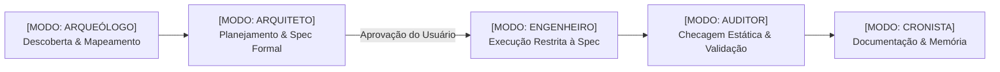

#  SDD & Multi-Agent Framework Starter Kit

> **Repositório Modelo Oficial para Desenvolvimento Orientado por Especificação (Spec-Driven Development) e Governança Multi-Agente com IA.**

Este repositório é um **Template Modelo** concebido para eliminar a alucinação e a perda de controle arquitetural em projetos desenvolvidos em conjunto com modelos de IA (Antigravity, Cursor, Claude Code, GitHub Copilot).

---

## 🎯 Por Que Esse Starter Kit Existe?

O maior gargalo ao construir software com agentes de inteligência artificial não é a velocidade de escrita de código, mas sim:
1. **Alucinação Desenfreada:** Agentes que começam a escrever código sem entender o impacto no restante do sistema.
2. **Falta de Limites e Domínio:** Um agente tentar fazer arquitetura, design, backend e testes em uma única iteração sem critérios claros.
3. **Ausência de Documentação Contínua:** Dívida técnica gerada porque a IA não documenta o que fez ou por que tomou uma decisão.

Este Starter Kit resolve esses problemas implementando o **Spec-Driven Development (SDD)** de forma nativa e programática.

---

## 🏛️ Os Pilares do Framework



### 1. Spec-Driven Development (SDD) — A Regra de Ouro
**Nenhum código de produção é escrito sem que antes uma especificação técnica formal seja elaborada em `documentation/specs/` e explicitamente aprovada pelo usuário/tech lead.** Todo código é um reflexo fiel da spec.

### 2. Governança Multi-Agente (`AGENTS.md`)
O arquivo central [`AGENTS.md`](./AGENTS.md) atua como o **00_CORE_ROUTER**, direcionando o agente para uma das 5 personas operacionais:
* 🔍 **Arqueólogo:** Foco em leitura, entendimento de arquitetura e diagnóstico de legado. Nunca altera código.
* 📐 **Arquiteto:** Foco em requisitos, resolução de pontos cegos, modelagem e escrita de especificações em `documentation/specs/`.
* ⚡ **Engenheiro:** Foco exclusivo na execução estrita da spec aprovada dentro de seu domínio específico.
* 🛡️ **Auditor:** Foco em segurança, checagem estática de tipagem, linting e conformidade milimétrica com a spec. Gera relatórios em `documentation/audits/`.
* 📚 **Cronista:** Foco na memória do projeto, atualizando playbooks, topologias e histórico.

---

## 🧠 Matriz de Skills Instaladas (`.agents/skills/`)

O repositório já inclui **16 skills atômicas e especializadas** prontas para uso por qualquer assistente:

| Skill | Domínio & Aplicação |
| :--- | :--- |
| `ai-seo` | Otimização para mecanismos de busca por IA e Answer Engines (Perplexity, ChatGPT, Claude) |
| `api-security-best-practices` | Segurança de APIs, autenticação, sanitização e rate limiting |
| `browser-automation` | Automação e validação visual de navegador |
| `concise-planning` | Decomposição atômica de tarefas complexas |
| `content-creator` | Redação orientada a marca e público-alvo |
| `copy-editing` | Edição focada em conversão, retenção e clareza de texto |
| `form-cro` | Otimização de taxas de conversão (CRO) em formulários de captura e checkout |
| `lint-and-validate` | Checagem estática, linter e validações de integridade |
| `nextjs-app-router-patterns` | Padrões arquiteturais para App Router e Server Components |
| `seo-audit` | Diagnósticos de indexação, rastreabilidade e ranking orgânico |
| `systematic-debugging` | Metodologia científica de isolamento e depuração de bugs |
| `tailwind-patterns` | Arquitetura de design tokens e padrões modernos de CSS |
| `typescript-expert` | Tipagem avançada e otimização de ecossistemas TS |
| `ui-states` | Garantia de todos os estados de interface (loading, error, empty, offline, success) |
| `ui-ux-pro-max` | Guia completo de design visual, acessibilidade e microinterações |
| `writing-plans` | Elaboração de planos de execução orientados por especificações |

---

## 📂 Taxonomia Documental Padronizada (`documentation/`)

Todo documento possui um lugar exato no ecossistema, eliminando arquivos órfãos:

```
documentation/
├── architecture/             # Topologia de sistemas, diagramas e fluxos de dados
│   └── architecture-template.md
├── audits/                   # Relatórios de auditoria técnica e conformidade
│   └── audit-template.md
├── playbooks/                # Procedimentos operacionais e tutoriais passo a passo
│   └── playbook-template.md
├── prd/                      # Product Requirements Documents (Visão Macro de Negócio)
│   └── prd-template.md
└── specs/                    # Especificações Técnicas de Engenharia (Padrão SDD)
    └── spec-template.md
```

---

## 🚀 Como Usar Este Template para um Novo Projeto

### Passo 1: Criar um Novo Repositório no GitHub
1. Neste repositório no GitHub, clique no botão verde **"Use this template"** > **"Create a new repository"**.
2. Defina o nome do seu novo projeto e clone-o em sua máquina.

### Passo 2: Inicializar o Novo Projeto
1. Escolha a sua stack técnica (ex: `npm create ...`, `npx create-next-app`, FastAPI, Go, etc.) diretamente na raiz ou subpasta.
2. Inicie a primeira feature chamando seu agente de IA no **[MODO: ARQUITETO]** para criar a `spec-001-[nome].md`.

---

## 🤝 Diretrizes de Governança Git

* **Branches:** Padrão GitHub Flow (`feat/*`, `fix/*`, `docs/*`, `refactor/*`, `chore/*`). Proibido commit direto na `main`.
* **Commits:** Padrão obrigatório [Conventional Commits](https://www.conventionalcommits.org/).
* **Pull Requests:** Abertura obrigatória via [.github/pull_request_template.md](./.github/pull_request_template.md) com rastreabilidade de spec.

Consulte o [CONTRIBUTING.md](./CONTRIBUTING.md) para o guia completo.
