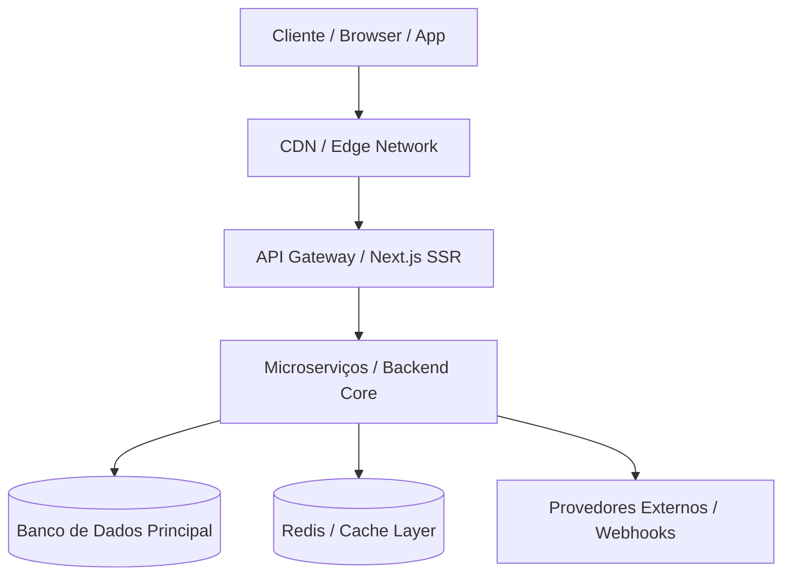

# Topologia & Arquitetura do Sistema

> **Status:** [Ativo | Em Evolução]  
> **Mantenedor:** [MODO: ARQUITETO / CRONISTA]  
> **Última Revisão:** [YYYY-MM-DD]

---

## 1. Visão Geral da Arquitetura
Descreva em alto nível como o sistema é estruturado, quais são as camadas principais (Frontend, Backend, Banco de Dados, Mensageria, Serviços Externos) e qual é o modelo de distribuição.

---

## 2. Diagrama de Topologia (Mermaid)

---

## 3. Componentes do Ecossistema

### 3.1. Camada de Apresentação (Frontend / Client)
- **Tecnologias:** [Ex: Next.js, React, Tailwind CSS, etc.]
- **Responsabilidades:** Renderização de interfaces, captura de intenção do usuário, validação client-side.

### 3.2. Camada de Negócio e Serviços (Backend / APIs)
- **Tecnologias:** [Ex: Node.js, Python FastAPI, Go, etc.]
- **Responsabilidades:** Execução de regras de negócio, autenticação, orquestração e sanitização.

### 3.3. Camada de Persistência & Dados
- **Tecnologias:** [Ex: PostgreSQL, Supabase, Redis, etc.]
- **Responsabilidades:** Armazenamento transacional, integridade referencial e retenção segura.

---

## 4. Fluxo de Dados Crítico
1. O usuário submete uma ação no frontend.
2. A requisição é autenticada e validada contra contratos definidos.
3. O serviço persiste o estado no banco de dados e emite eventos para mensageria/webhooks.
4. Resposta estruturada é retornada ao cliente com feedback visual imediato.

---

## 5. Diretrizes de Segurança & Observabilidade
- **Autenticação & Autorização:** [JWT, OAuth2, RBAC, etc.]
- **Logs & Telemetria:** Estruturação de logs em JSON com rastreabilidade de correlação (`correlation-id`).
- **Segredos & Envs:** Nenhuma credencial trafega no código-fonte; injeção via variáveis de ambiente seguras.
